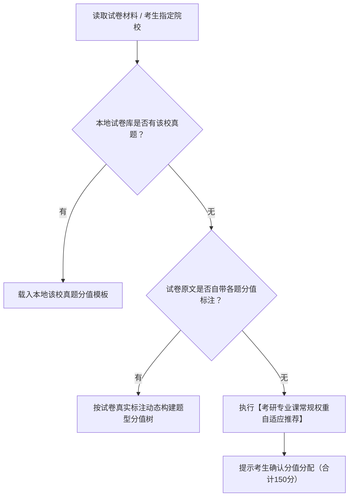

# 高校试卷结构自适应引擎（高校自主命题规范库）

考研专业课《信号与系统》（科目代码通常为 8xx 或 9xx）为**招生单位自主命题**。
不同于全国统考数学二的固定题型，各大高校在题型组合、题量、小题分值与考查风格上差异显著。
批改前，必须先匹配目标院校题型结构，动态生成评分表格与总分统计。

---

## 一、主流名校试卷结构与分值模板速查

### 1. 华中科技大学（824 信号与线性系统）
- **满分体系**：150 分
- **标准题型结构**：
  - **一、单项选择题**：10 题 × 2 分 = **20 分**（考查基础概念、性质、变换存在条件、因果稳定性）
  - **二、填空题**：10 题 × 3 分 = **30 分**（考查冲激性质、变换式数值、卷积和、终值初值）
  - **三、简答与综合分析题**：5 题 × 10 分 = **50 分**（傅里叶级数/功率、DTFT序列抽取与画图、差分方程、离散状态方程与转移函数）
  - **四、综合大计算题**：3 题（通常为 15 + 15 + 20 分）= **50 分**（时域卷积与状态响应、连续采样与低通恢复、S域全响应与初值反推）
- **风格特征**：题量大、题型全、概念性与计算量并重，离散时间系统与采样定理考查极细致。

---

### 2. 北京邮电大学（801 / 804 信号与系统）
- **满分体系**：150 分
- **标准题型结构**：
  - **一、单选题 / 填空题**：约 30~40 分
  - **二、连续时间系统时域与频域综合题**：约 30 分（冲激响应、频率响应、无失真传输与滤波）
  - **三、复频域电路分析大题**：约 25 分（S域等效阻抗模型、运算放大器电路、全响应分解）
  - **四、离散系统与 Z 变换大题**：约 25 分（差分方程、Z 域系统函数、反变换求响应）
  - **五、系统状态变量与信号流图大题**：约 20~25 分（梅森增益公式、状态方程建立与求解）
- **风格特征**：电路结合度高（运放、S域阻抗分析），极重信号流图梅森公式与系统状态空间求解。

---

### 3. 西安电子科技大学（811 信号与系统、电路）
- **满分体系**：150 分（若单考信号则为 150 分；若为信号+电路合卷则信号占 75 分或 100 分）
- **标准题型结构（纯信号卷）**：
  - **一、填空题 / 概念选择题**：约 30~40 分
  - **二、波形卷积与时域分析**：约 20 分（图形卷积法、奇异信号运算）
  - **三、连续时间傅里叶变换与抽样**：约 25 分
  - **四、拉普拉斯变换与系统特性**：约 25 分（极零点分布、几何作图求频响、Bode 图）
  - **五、离散时间傅里叶与 Z 变换**：约 25 分
  - **六、状态变量分析法**：约 15~20 分
- **风格特征**：几何作图法（由极零点矢量求频响幅度/相位）、波形图卷积几何分段考查频繁。

---

### 4. 电子科技大学（831 信号与系统、数字信号处理）
- **满分体系**：150 分
- **标准题型结构**：
  - **一、单项选择题**：约 20~30 分
  - **二、简答题 / 填空题**：约 20~30 分
  - **三、综合计算题**：5~6 大题，每题 15~20 分，合计 90~100 分
- **风格特征**：常延伸至数字信号处理（DSP）基础（如 DFT、FFT 基本概念与离散滤波器）。

---

### 5. 东南大学（920 专业基础综合 / 信号与系统）
- **满分体系**：150 分
- **标准题型结构**：
  - 以**大题（简答题与计算题）为主**，极少或无客观题（通常为 7~9 道大题，每题 15~25 分）；
  - 核心涵盖：时域响应、连续频域、复频域分析、离散时间系统、状态变量法。
- **风格特征**：大题分值高，步骤推导要求极高，极注重数学物理推导的自洽性与严密性。

---

### 6. 清华大学（828 信号与系统）
- **满分体系**：150 分
- **标准题型结构**：
  - 全卷通常仅 6~8 道深度综合大题（每题 15~30 分），无机械死记硬背的选择填空；
  - 强调系统设计、逆问题求解、系统辨识与通信系统综合建模。

---

## 二、通用高校动态自适应算法（SOP）

当考生上传其他高校（如华南理工、哈工大、天大、武大、华东师大、北理工等）的试卷或未指定高校时，按以下机制动态生成评分标准：



### 考研专业课常规权重推荐基准（合计 150 分）：
1. **若包含客观题**：
   - 选择题：每题 2~3 分，小计约 20~30 分；
   - 填空题：每题 3~5 分，小计约 20~30 分；
   - 客观题合计约 40~60 分。
2. **主观大题部分**：
   - 简答/波形题：每题 8~10 分，小计约 20~40 分；
   - 综合计算大题：4~6 题，每题 12~20 分，小计约 60~80 分；
3. **若全卷全为主观大题**：
   - 7~9 道大题，平均每题 15~20 分，总计 150 分。

---

## 三、试卷结构确认协议（启动门控中执行）

在整卷批改的启动门控阶段，向考生输出的结构确认示例：

```markdown
> 🎯 **试卷题型分值自适应检测**：
> - **目标院校与科目**：2023年华中科技大学 824 信号与系统
> - **分值结构体系**：
>   - 一、单选题（第 1~10 题，每题 2 分，共 20 分）
>   - 二、填空题（第 11~20 题，每题 3 分，共 30 分）
>   - 三、简答题（第 21~25 题，每题 10 分，共 50 分）
>   - 四、计算题（第 26 题 15 分，第 27 题 15 分，第 28 题 20 分，共 50 分）
> - **全卷满分**：150 分
> 
> 请确认以上题型分值分配是否符合你的卷面要求。确认无误请回复「**开始批改**」。
```
